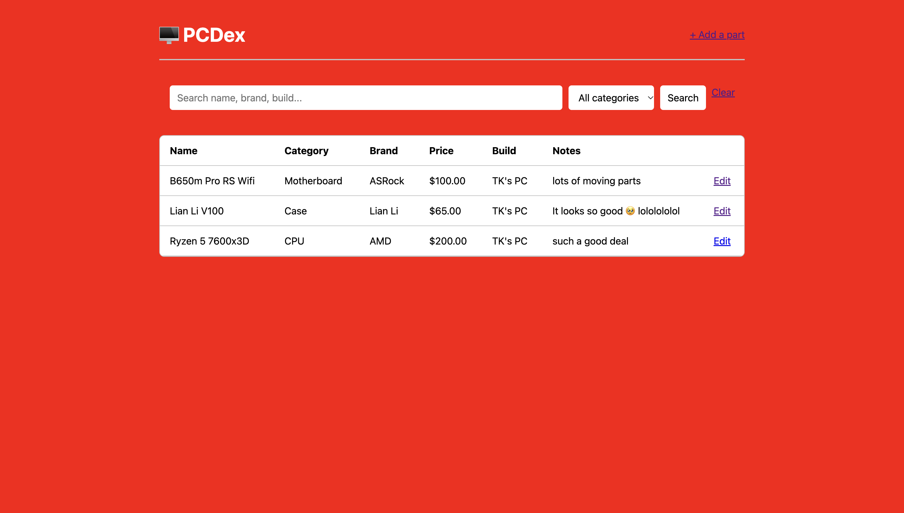
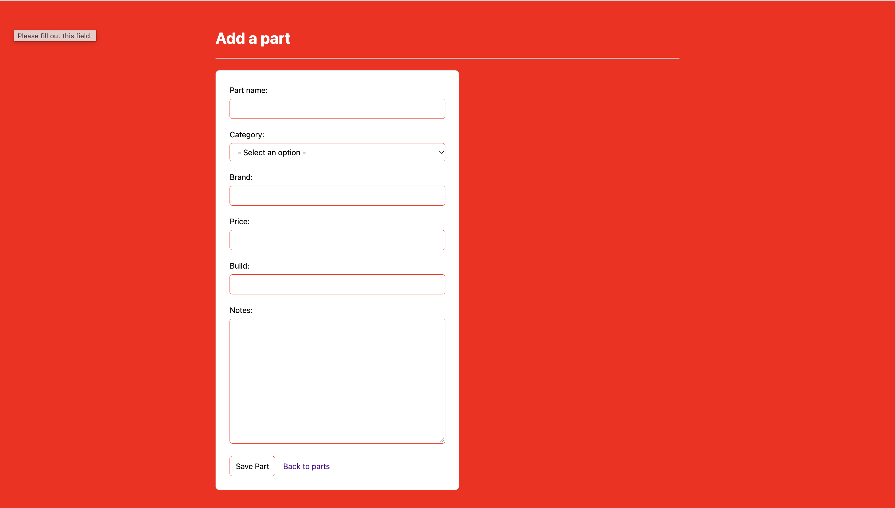
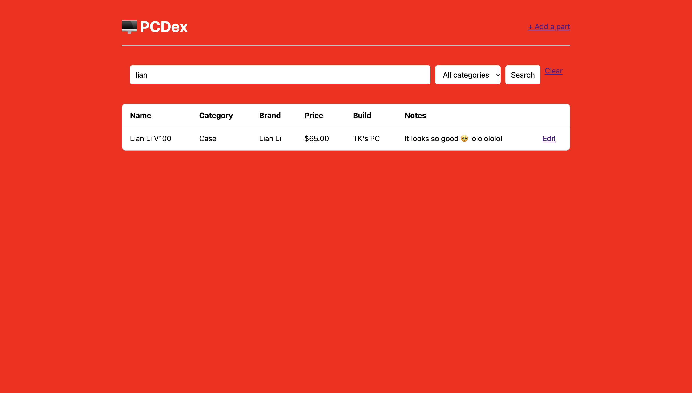

# PCDex: PC Build & Parts Tracker

PCDex is a Django web app for keeping track of PC parts across one or more builds. You log each component (name, category, brand, price, build, notes), then search and filter to find what you need. The name and look are a nod to the Pokédex: catalog your parts like a collection.

Built for the Tech Exercise in CSCI 4830 (Introduction to Software Engineering) at the University of Nebraska Omaha.

## Features

- **Add Part**: form to save a part with its name, category, brand, price, build, and notes
- **Search & Filter**: keyword search across name, brand, build, and notes (case-insensitive), plus a category dropdown; both can be combined
- **Edit Part**: update a saved part using the same form, pre-filled
- **Parts list**: newest parts first, shown as cards

Categories: CPU, GPU, Motherboard, RAM, Storage, Power Supply, Case, Cooler, Other.

## Screenshots

| Parts list | Add a part | Search & filter |
|---|---|---|
|  |  |  |

## Tech Stack

| Layer | Tool |
|---|---|
| Web framework | Django 6.1.1 (Python 3.12+) |
| Database | SQLite |
| Hosting | AWS EC2 (Ubuntu) |
| Version control | Git + GitHub |

## Project Structure

```
pcdex/            Django project settings and root URLs
pages/            The app: model, form, views, URLs, templates
  models.py       Part model
  forms.py        PartForm (ModelForm)
  views.py        part_list, add_part, edit_part, hello_world
  templates/pages/
    base.html     Shared layout and styling
    part_list.html
    add_part.html Used for both adding and editing
requirements.txt
manage.py
```

## Run It Locally

```bash
git clone https://github.com/tk-dao/IntroSWETechExercise.git
cd IntroSWETechExercise

python3 -m venv venv
source venv/bin/activate        # Windows: venv\Scripts\activate

pip install -r requirements.txt
python manage.py migrate
python manage.py runserver
```

Open http://127.0.0.1:8000/

## Deploy on AWS EC2

1. **Launch an instance**: Ubuntu Server, free-tier type (t2.micro or t3.micro), with a key pair.
2. **Security group inbound rules**:
   - SSH, port 22, source: My IP
   - Custom TCP, port 8000, source: 0.0.0.0/0
3. **Connect**:
   ```bash
   ssh -i your-key.pem ubuntu@<public-ip>
   ```
4. **Install system packages**:
   ```bash
   sudo apt update
   sudo apt install -y git python3-venv sqlite3
   ```
5. **Set up the app** (same as local):
   ```bash
   git clone https://github.com/tk-dao/IntroSWETechExercise.git
   cd IntroSWETechExercise
   python3 -m venv venv
   source venv/bin/activate
   pip install -r requirements.txt
   python manage.py migrate
   ```
6. **Allow the server's IP**: add the instance's public IPv4 address to `ALLOWED_HOSTS` in `pcdex/settings.py`. The public IP changes every time the instance is stopped and started (unless you attach an Elastic IP), so update this after a restart.
7. **Start the server** so it keeps running after you log out:
   ```bash
   nohup python manage.py runserver 0.0.0.0:8000 &
   ```
8. Visit `http://<public-ip>:8000/`

### Updating the server

```bash
cd IntroSWETechExercise
source venv/bin/activate
git pull
python manage.py migrate
pkill -f runserver
nohup python manage.py runserver 0.0.0.0:8000 &
```

## Viewing the Database

```bash
sqlite3 db.sqlite3 ".tables"
sqlite3 db.sqlite3 "SELECT * FROM pages_part;"
```

`db.sqlite3` is in `.gitignore`, so each environment has its own data. The migration files are committed, so `migrate` builds the same table structure everywhere.

## URLs

| Path | Page |
|---|---|
| `/` | Parts list with search and filter |
| `/add/` | Add a part |
| `/edit/<id>/` | Edit a part |
| `/hello/` | Original Hello World page |

## Notes

This runs on Django's development server with `DEBUG = True`, which is fine for a class demo. For real production you'd set `DEBUG = False`, move `SECRET_KEY` into an environment variable, and serve with Gunicorn behind Nginx.
